# 💄 SUGAR Cosmetics — Instagram Performance Analytics

<p align="center">
  <strong>Interactive Social Media Analytics | Streamlit · Python · Plotly · Business Intelligence</strong>
</p>

<p align="center">
  <a href="https://instagram-performance-analytics-sugar-cosmetics-t8k96n9oc6.streamlit.app/"><strong>🚀 Open Live Dashboard</strong></a>
</p>

<p align="center">
  An interactive analytics dashboard for exploring Instagram content performance, engagement patterns, campaign effectiveness, audience signals, and follower growth for SUGAR Cosmetics.
</p>

---

## Project at a glance

| Area | Details |
|---|---|
| Project | Instagram Performance Analytics for SUGAR Cosmetics |
| Dashboard | Streamlit web application |
| Visualization | Plotly interactive charts |
| Dataset shown in the app | 50,000 posts |
| Displayed analysis period | 19 April 2024 – 19 April 2025 |
| Primary use case | Social media performance monitoring and content strategy |
| Live demo | [Launch the Streamlit app](https://instagram-performance-analytics-sugar-cosmetics-t8k96n9oc6.streamlit.app/) |

> **Data note:** Metrics and observations in the dashboard describe the dataset loaded into this portfolio project. They should not be interpreted as verified SUGAR Cosmetics account performance or official company reporting unless independently validated.

## Business problem

Social media teams need to understand more than how many likes a post receives. They need to compare content formats, campaign types, publishing days, engagement sources, hashtags, and audience signals to make more informed content decisions.

This project brings those dimensions into one interactive dashboard. Users can filter the data and explore performance across multiple analytical views instead of relying on static reports.

## Dashboard walkthrough

### 1. Executive overview
- KPI cards for post count, likes, comments, reach, engagement rate, impressions, shares, saves, new follows, and profile-visit-to-follow conversion.
- Monthly reach-versus-engagement trend visualization.
- A consolidated view for quickly assessing the selected dataset.

### 2. Trends
- Monthly post volume.
- Monthly average engagement rate.
- Content-type mix over time.
- Supports exploration of posting consistency and changes in engagement.

### 3. Content performance
- Average likes, comments, and saves by post type.
- Engagement-rate lift by post type and campaign type.
- Campaign-by-format engagement-rate heatmap.
- Helps compare Image, Reel, Story, and Video content in the selected data.

### 4. Publishing-time analysis
- Average engagement rate by weekday.
- Weekday lift versus the overall average.
- Weekday-by-post-type heatmap.
- Useful for forming hypotheses about publishing schedules; differences should be tested before changing the content calendar.

### 5. Engagement funnel
- Impressions → Reach → Likes → Comments → Shares → Saves.
- Funnel conversion indicators, including reach/impressions, likes/reach, comments/likes, and saves/reach.
- Helps examine how the selected dataset moves across the displayed engagement stages.

### 6. Hashtag analysis
- Average engagement rate by hashtag.
- Hashtag usage share.
- Top hashtag combinations by engagement rate, with a minimum-post threshold shown in the app.
- Supports comparison of hashtag patterns rather than assuming that a frequently used hashtag causes higher engagement.

### 7. Audience and growth
- Engagement rate by audience emotion label.
- Engagement-source comparison using reach, engagement rate, and average follows.
- New-follow and cumulative-follow trend.
- Profile-visit-to-follow conversion by campaign.
- These views support exploratory audience and growth analysis; they do not establish causality.

### 8. Top posts
- Top 10 posts by likes.
- Top 10 posts by engagement rate.
- Detail table with post label, likes, comments, shares, saves, reach, engagement rate, and hashtags.
- The dataset does not include a caption column, so posts are identified by post ID, date, type, and campaign.

### 9. Insights & optional AI assistant
- Rule-based insights update with the selected filters.
- Suggested strategy points summarize the strongest and weakest observed segments.
- An optional AI question interface is included for asking questions about filtered data. It requires the appropriate API key in Streamlit secrets; the core dashboard and displayed insights can be used without it.

## Interactivity

The sidebar includes filters for:
- Date range
- Post type
- Campaign type
- Engagement source
- Audience emotion
- Hashtags

The intent is to let users compare segments across the dashboard and investigate specific combinations rather than rely only on aggregate metrics.

## Example observations visible in the screenshots

The following are examples from the displayed dashboard state, not universal conclusions. The figures may change when filters are changed.

- The overview shows **50,000 posts** for the selected period.
- The overview displays an average engagement rate of **18.54%**.
- In the shown content comparison, Reels have an average engagement rate of **18.61%**, while Images show **18.43%**.
- In the shown weekday comparison, Wednesday is displayed at **18.63%** and Sunday at **18.42%**.
- The displayed insights panel explicitly cautions that segment differences are small and should be treated as hypotheses for A/B testing, not proven winners.

**Interpretation:** The visible differences are relatively narrow. A practical next step is to validate them with controlled tests and compare results by reach, engagement quality, audience growth, and business objectives—not engagement rate alone.

## Metric definitions

The dashboard header defines engagement rate as:

**Engagement rate = (Likes + Comments + Shares + Saves) ÷ Reach**

Confirm whether the application formats this ratio as a percentage in each chart or KPI before comparing it with external benchmarks. Other metrics, including impressions, reach, follows, and profile-visit conversion, depend on the definitions and data available in the underlying dataset.

## Technology

The visible application is built with:
- **Python** — data processing and application logic
- **Streamlit** — interactive dashboard interface
- **Plotly** — interactive charts and visual exploration
- **Pandas** — commonly used for tabular analysis; confirm the exact implementation in `app.py` and `requirements.txt`

The project repository also contains an Excel dataset, a CSV dataset, documentation, and a `requirements.txt` file, based on the project structure previously shared.

## Repository contents

The project files shared for this repository include:

```text
Instagram Performance Analytics for Sugar Cosmetics/
├── app.py
├── requirements.txt
├── README.md
├── .gitignore
├── .streamlit/
│   └── config.toml
├── sugar_cosmetics_instagram_data.xlsx
├── sugar_cosmetics_instagram_data - sugar_cosmetics_instagram_data.csv.csv
├── Project Title.docx
├── sugar-costmetics.docx
├── Sugar_Cosmetics_Business_Summary.docx
├── Sugar_Cosmetics_Instagram_Insights.docx
├── Sugar_Cosmetics_Instagram_Insights (1).docx
├── Power_BI_Dashboard_End_to_End_Guide.docx
└── project_structure.txt
```

This is a representation of the files shared for the project; adjust it to match the current GitHub repository. Do not commit `.venv/`, credentials, API keys, caches, or unnecessary generated files.

## Run locally

### 1. Clone the repository

Replace `YOUR_GITHUB_USERNAME` with your GitHub username and verify the repository name.

```bash
git clone https://github.com/YOUR_GITHUB_USERNAME/Instagram-Performance-Analytics-SUGAR-Cosmetics.git
cd Instagram-Performance-Analytics-SUGAR-Cosmetics
```

### 2. Create and activate a virtual environment (Windows CMD)

```bat
py -3.11 -m venv .venv
.venv\Scripts\activate
```

Use a Python version supported by the dependencies in your `requirements.txt`.

### 3. Install dependencies

```bat
python -m pip install --upgrade pip
pip install -r requirements.txt
```

### 4. Start the app

```bat
streamlit run app.py
```

If the app expects the dataset at a particular path, keep the file in that location or update the path in `app.py`.

## Optional AI assistant configuration

The app may show a message asking for `ANTHROPIC_API_KEY` in Streamlit secrets to enable the optional AI assistant. Do not put a real API key in source code or commit it to GitHub.

For local Streamlit use, create `.streamlit/secrets.toml`:

```toml
ANTHROPIC_API_KEY = "your-api-key-here"
```

Add `secrets.toml` to `.gitignore`. In Streamlit Community Cloud, open the app's **Settings → Secrets** and add the secret using the format expected by the application. Never publish the key in screenshots, logs, notebooks, or commits. If the AI feature is not configured, use the dashboard's non-AI charts and rule-based insights.

## Business value

This dashboard is designed to help social media and marketing stakeholders:
- Compare content formats and campaign categories using consistent metrics.
- Explore changes in posting volume, reach, and engagement over time.
- Identify promising weekday, hashtag, and audience segments for further testing.
- Inspect top-performing posts and the engagement signals behind their rankings.
- Turn descriptive analysis into testable content-calendar and campaign hypotheses.

These are decision-support capabilities, not guarantees of campaign lift or sales impact.

## Limitations and responsible interpretation

- The dataset is the source of the dashboard figures; its representativeness and provenance should be documented before drawing conclusions about the real brand account.
- Correlation and segment averages do not prove that a content type, weekday, campaign, or hashtag caused a result.
- Partial months can distort month-to-month comparisons. The dashboard notes that April 2024 and April 2025 are partial months in the displayed period.
- The engagement-rate formula and all denominator definitions should be validated before benchmarking.
- Follower and conversion metrics should be checked against their source definitions to avoid treating post-attributed follows as total account growth.
- The optional AI assistant depends on a correctly configured secret and external API access.

## Recommended next steps

- Add data provenance, refresh date, and data dictionary documentation.
- Add CSV/XLSX validation and clear handling for missing or invalid values.
- Add export options for filtered summary tables and chart data.
- Track campaign outcomes beyond engagement where reliable data is available.
- Run controlled A/B tests to validate small differences between content segments.
- Add automated tests for metric calculations and filter behavior.

## Screenshots

Add dashboard screenshots to a repository folder such as `screenshots/` and embed them here once they have been committed:

```markdown
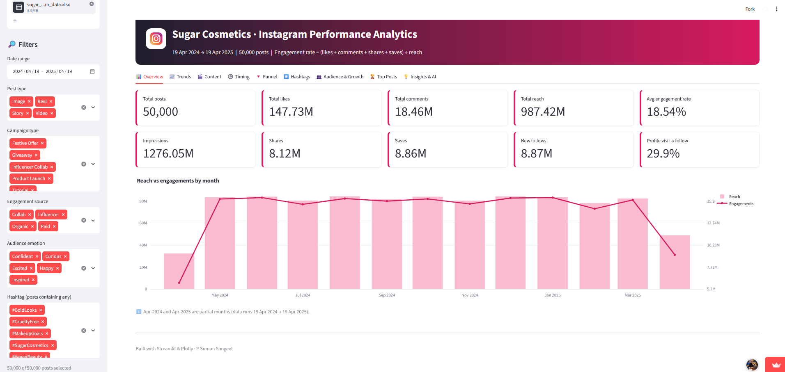
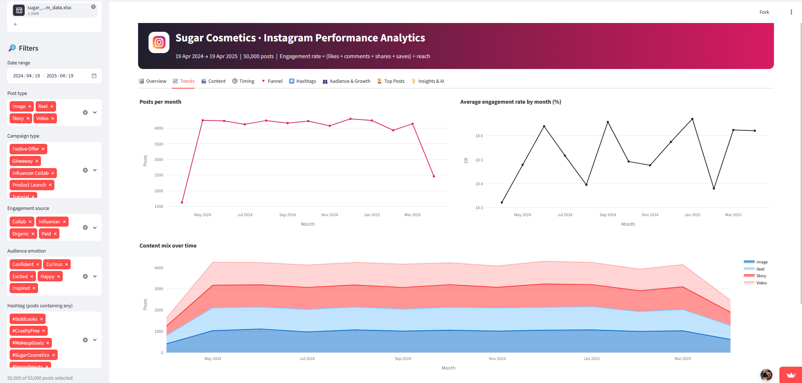
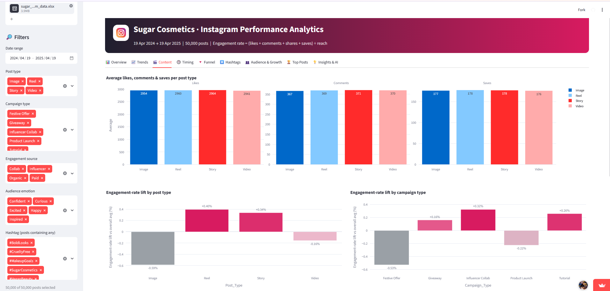
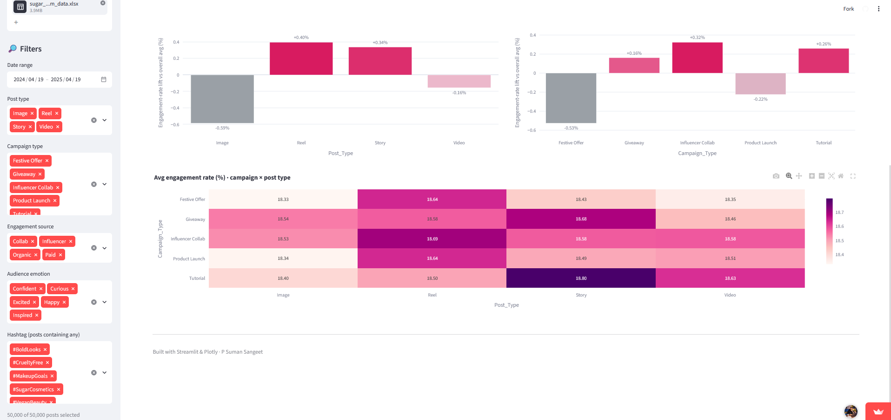
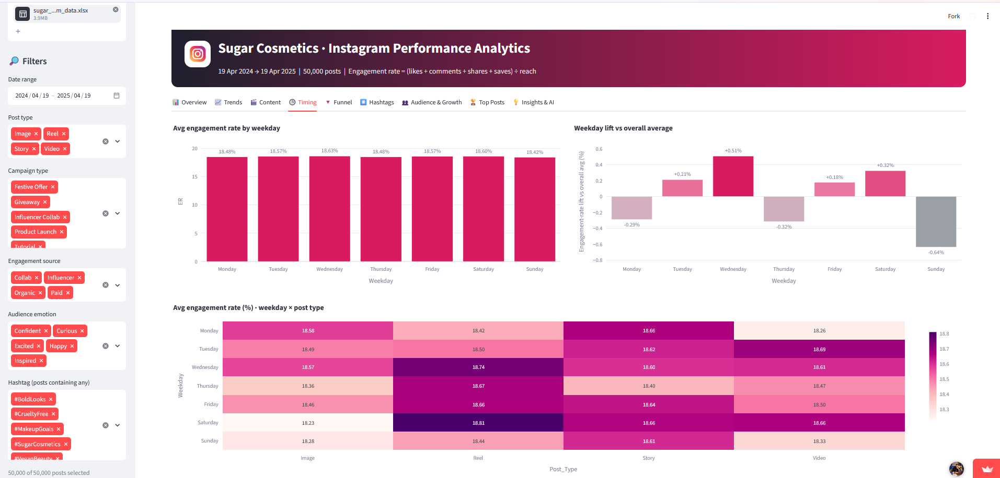
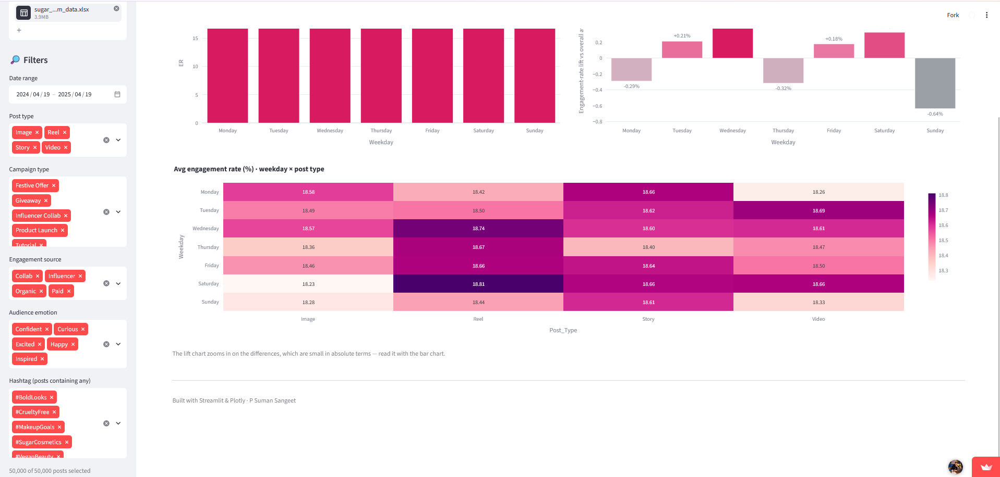
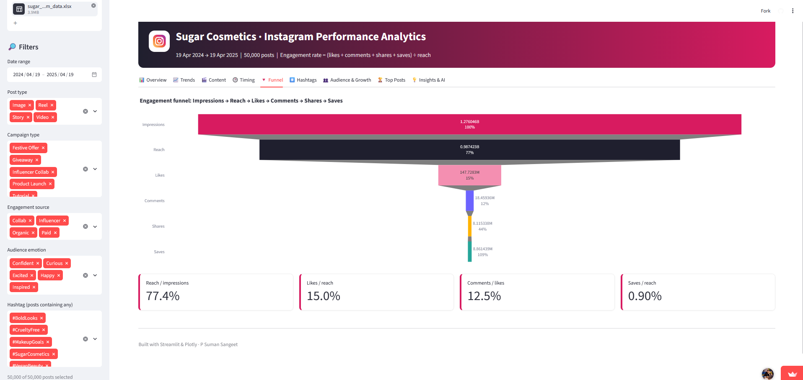
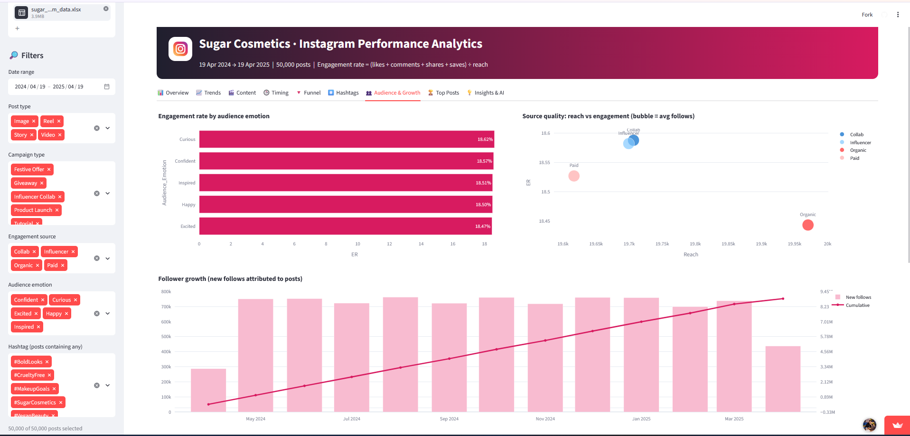
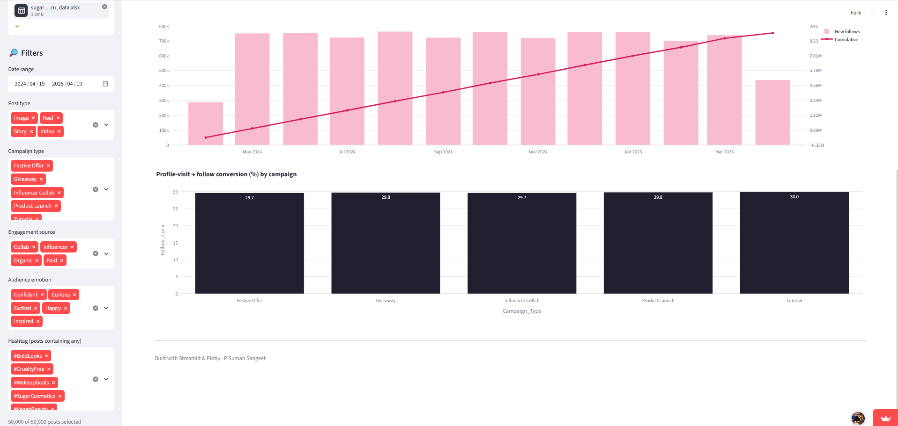
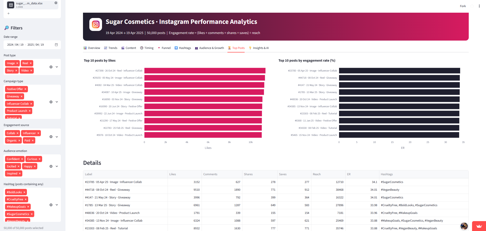
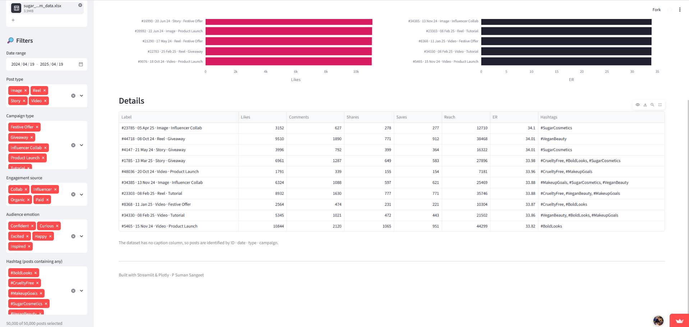
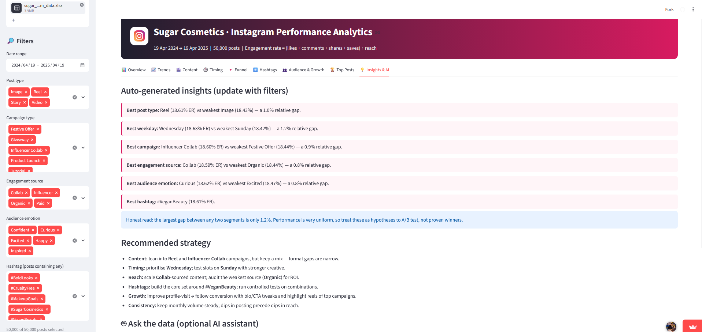
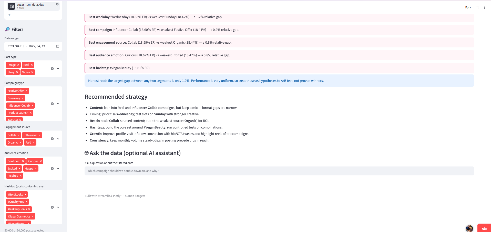
```

Use screenshots that do not expose API keys, account secrets, or private data.

## Author

**Riya Gupta**  
BCA graduate, pursuing MCA (AI & DS)

- GitHub: [https://github.com/Riyagupta321]
- LinkedIn: [https://github.com/Riyagupta321]
- Live dashboard: [Instagram Performance Analytics — SUGAR Cosmetics](https://instagram-performance-analytics-sugar-cosmetics-t8k96n9oc6.streamlit.app/)

---

<p align="center">
  <strong>Explore the dashboard · Investigate the data · Turn patterns into testable decisions</strong>
</p>
